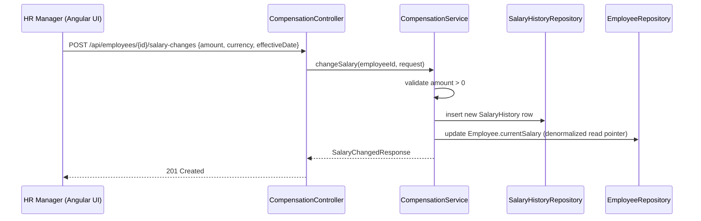
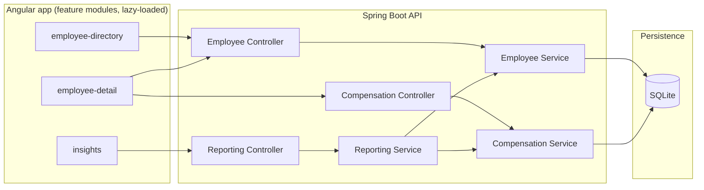

# Spec: Give ACME's HR manager a web app to manage and understand 10,000 employees' pay

> Owned by: Candidate (Java role applicant) · Started: 2026-09-30 · Last revised: 2026-09-30 · Spec UUID: 1e5d4eef-d84e-45d1-b413-cf3943dff80b
> Anthara spec — slice-decomposed, categorically-framed. Feeds /anthara:create-ticket and /anthara:plan-implementer.

---

## At a glance

| | |
|---|---|
| **In one line** | Replace ACME HR's spreadsheet-based salary tracking with a web app to browse, edit, and report on 10,000 employees' pay. |
| **Slices** | 8, built in the order listed in [§5](#5-slices) |
| **Architectural style** | Modular monolith, from [§7.2](#72-architectural-style) |
| **Active packs** | Accessibility Checklist, Angular Frontend Standards, Clean Code, Incubyte Engineering Standards, Java Testing Standards, SonarJava Violations (Java), Spring Boot Backend Standards |
| **Open questions** | 0 — none; see [§8](#8-open-questions) |

## 1. Overview & business context

**The problem.** ACME's HR team manages salary data for 10,000 employees across multiple countries in spreadsheets [1]. This is tedious to maintain, error-prone at that scale, and cannot answer aggregate questions ("how does the org pay people?") without manual pivot-table work.

**Who it is for.** The **HR Manager** [§3.1](#31-kinds-of-users) — the sole user of this system — who needs to look up and update any employee's pay, and needs org-wide and segmented views of compensation.

**What this spec commits to.** A web app with an employee directory (search, filter, sort, page), a per-employee detail view with profile editing and an append-only salary-change history, an onboarding flow for new hires, and an Insights page answering "how does the org pay people" with headcount and average/median salary broken down by department, country, and job level.

**Deliberately out of scope.** Authentication/login, cross-currency conversion, employee termination/lifecycle workflows, and any export or BI-tool integration. Each is called out with its reasoning in [§9](#9-deferred-follow-ups-and-accepted-limits) rather than silently dropped.

## 2. Sources

| ID | Type | Contributor | Date | Description |
|---|---|---|---|---|
| 1 | Assignment brief (`kata.md`, repo root) | Hiring team | 2026-09-30 | The take-home assessment brief: goal, persona, requirements, technical constraints, submission instructions. |
| 2 | Fabric standard packs (org-wide) | `mcp__plugin_anthara_anthara-fabric__get_relevant_standards` | 2026-09-30 | Spring Boot Backend, Java Testing, Angular Frontend, Accessibility Checklist, Incubyte Engineering, SonarJava Violations, Clean Code — see [§6](#6-nfrs--regulatory-compliance) for rules cited. |
| 3 | Codebase (this repo) | n/a | 2026-09-30 | Greenfield — repo contains only `kata.md`; no prior code, stack, or design system to inherit. |
| 4 | Live spec-writing session | Candidate, via `/anthara:start` → `/anthara:spec-writer` | 2026-09-30 | In-session decisions: architecture (modular monolith), database (SQLite), migrations (Flyway), auth (none), component library (Angular Material), layout (table + side-panel), currency handling (multi-currency, no FX), salary history (append-only), employee fields, seed-data realism. |
| 5 | End-of-spec review (`reviewer` + 6 pack-reviewers) | `/anthara:plan-implementer` | 2026-09-30 | Full-diff review across architecture/code-quality/test-quality/accessibility and the Spring Boot Backend, Java Testing, Angular Frontend, Accessibility Checklist, Incubyte Engineering, and SonarJava Violations packs. 0 high, 13 medium, 11 low findings; genuine findings fixed in one follow-up commit, two medium findings confirmed as already-reasoned plan decisions (see §9.5/§9.6). |

## 3. Type ontology

### 3.1 Kinds of users
- **HR Manager** — the sole actor in this system; browses, edits, and reports on all employees. No other role exists in this MVP [1, 4].

### 3.2 Kinds of data
- **Employee** — one person's HR record: name, department, job title/level, country, hire date, optional manager reference, and current salary (amount + currency). Sensitive PII, but not a regulated data class under this repo's active packs [1, 4].
- **SalaryHistory** — one immutable, timestamped salary value for one employee: amount, currency, effective date, recorded-at timestamp. The audit trail of every change [4].
- **Department** — a named organizational unit an employee belongs to (e.g., Engineering, Sales); a plain reference value, not a separately manageable entity in this MVP [4].
- **Country** — the ISO country an employee is based in; carries the employee's currency context [1, 4].

### 3.3 Kinds of events
- **EmployeeCreated** — fires when the HR manager onboards a new employee ([slice 5.6](#56-add-a-new-employee)); also creates the employee's first SalaryHistory record.
- **EmployeeProfileUpdated** — fires when non-salary fields change ([slice 5.3](#53-edit-an-employees-profile)).
- **SalaryChanged** — fires when a new salary is recorded ([slice 5.4](#54-change-an-employees-salary)); always appends a SalaryHistory record, never overwrites one.

### 3.4 Kinds of states
This domain has no persisted lifecycle state machine. Every Employee record is implicitly active; there is no termination or status workflow in this MVP — see [§9.3](#9-deferred-follow-ups-and-accepted-limits).

## 4. Invariants

**4.1 One current salary** — Every employee has exactly one current salary, in exactly one currency, at all times. Sources: [1, 4].

**4.2 Salary history is append-only** — A SalaryHistory record, once created, is never modified or deleted; a salary change always creates a new record. Sources: [4].

**4.3 Salary is a positive, exact decimal** — A salary amount is always a positive, non-zero `BigDecimal` value paired with its currency code, never a floating-point type. Sources: [2, 4].

**4.4 Current salary tracks the latest history entry** — An employee's current salary always equals the SalaryHistory record with the most recent effective date for that employee. Sources: [4].

## 5. Slices

Outside-in, independently testable, sequenced for build. This table is the build order — `/anthara:plan-implementer` executes it top to bottom.

| # | Slice | What the user can do once it lands | Entry | Reached from |
|---|---|---|---|---|
| 5.1 | Browse the employee directory | Search, filter, sort, and page through all 10,000 employees | Employee Directory screen | `root` |
| 5.2 | View an employee's full detail | Open a side panel showing one employee's full profile | Employee detail side-panel | *Employee Directory screen* (5.1) |
| 5.3 | Edit an employee's profile | Update department, title, country, hire date, manager | "Edit profile" action | *Employee detail side-panel* (5.2) |
| 5.4 | Change an employee's salary | Record a new salary as an immutable history entry | "Change salary" action | *Employee detail side-panel* (5.2) |
| 5.5 | View an employee's salary history | Review every past salary change, newest first | "History" tab | *Employee detail side-panel* (5.2) |
| 5.6 | Add a new employee | Onboard a new employee with their starting salary | "Add employee" button | *Employee Directory screen* (5.1) |
| 5.7 | View organization-wide pay insights | See headcount and avg/median salary by dept/country/role | Insights page | `root` |
| 5.8 | Filter pay insights by department, country, or role | Narrow insights to a specific population | Filter controls | *Insights page* (5.7) |

### 5.1 Browse the employee directory

When the HR manager opens the app, they land on the Employee Directory: a paginated, sortable, filterable table of all 10,000 employees showing name, department, job title, country, and current salary. They can search by name and filter by department, country, and job title to narrow the population they care about.

*Types: Employee, Department, Country [§3.2](#32-kinds-of-data) · Invariants: [4.1](#4-invariants).*

```
┌─ Employee Directory ─────────────────────────────────────────────┐
│ Search: [___________]  Dept:[All ▾] Country:[All ▾] Title:[All ▾]│
├────────────┬────────────┬───────────┬──────────┬─────────────────┤
│ Name       │ Department │ Job Title │ Country  │ Salary          │
├────────────┼────────────┼───────────┼──────────┼─────────────────┤
│ Jane Ito   │ Engineering│ Sr. Eng.  │ Japan    │ ¥9,800,000      │
│ ...        │            │           │          │                 │
├────────────┴────────────┴───────────┴──────────┴─────────────────┤
│                                     ◂ 1 2 3 … 400 ▸  [25/page ▾]  │
└────────────────────────────────────────────────────────────────────┘
```

**Acceptance criteria**

- [x] **5.1.1** The directory lists employees in a paginated table (default page size 25, capped maximum enforced server-side), showing name, department, job title, country, and current salary with its currency.
- [x] **5.1.2** The HR manager can search employees by name (case-insensitive, partial match).
- [x] **5.1.3** The HR manager can filter the list by department, country, and job title, independently or combined.
- [x] **5.1.4** The HR manager can sort the table by name, department, country, job title, or current salary, ascending or descending.
- [x] **5.1.5** List endpoints never return more rows than the configured page size, regardless of the 10,000-row dataset.
- [x] **5.1.6** Running the seed script against a fresh database populates exactly 10,000 employee records spanning multiple countries, departments, and job levels with realistic salary distributions; re-running it against the same fresh database is idempotent (no duplicate rows).
- [x] **5.1.7** An empty search/filter result shows a clear "no employees match" state, not a blank table or an error.
- [x] **5.1.8** Table headers, sort controls, and pagination controls are reachable and operable by keyboard, with visible focus indicators.

### 5.2 View an employee's full detail

Clicking any row in the directory opens a side-panel drawer showing that employee's full profile — name, department, job title, country, hire date, manager, and current salary — without losing the directory table's scroll, sort, or filter state.

*Types: Employee [§3.2](#32-kinds-of-data) · Invariants: [4.1](#4-invariants).*

**Acceptance criteria**

- [x] **5.2.1** Clicking a directory row opens the detail side-panel for that employee, preserving the directory's current page, sort, and filters underneath.
- [x] **5.2.2** The detail panel shows every core employee field: name, department, job title, country, hire date, manager, current salary + currency.
- [x] **5.2.3** Closing the panel, via a close control or Escape, returns keyboard focus to the row that opened it.
- [x] **5.2.4** The panel traps keyboard focus while open and restores it to the trigger on close.
- [x] **5.2.5** Requesting a non-existent employee id returns a `404` Problem Details response with a `code` and `message`, and the UI surfaces a "not found" message.

### 5.3 Edit an employee's profile

From the detail panel, the HR manager edits an employee's department, job title, country, hire date, and manager — everything except salary, which changes only through its own guarded flow in [slice 5.4](#54-change-an-employees-salary). Saving validates the form and updates the record in place.

*Types: Employee [§3.2](#32-kinds-of-data) · Invariants: none beyond field-level validation (AC 5.3.2).*

**Acceptance criteria**

- [x] **5.3.1** The HR manager can edit department, job title, country, hire date, and manager from the detail panel's edit mode.
- [x] **5.3.2** Required fields (department, job title, country, hire date) cannot be saved blank; the form surfaces field-level validation errors tied to their inputs.
- [x] **5.3.3** An invalid manager reference (an employee id that does not exist) is rejected with a `422` Problem Details response naming the invalid field.
- [x] **5.3.4** Saving a valid edit updates the employee and reflects the change in the directory table and detail panel without a full page reload.
- [x] **5.3.5** The salary field is read-only in this flow; it never changes here, only through slice 5.4.

### 5.4 Change an employee's salary

The HR manager records a salary change — a raise, correction, or initial assignment — by entering a new amount, currency, and effective date. The system records the change as a new, immutable salary-history entry, which becomes the employee's current salary.

*Types: Employee, SalaryHistory [§3.2](#32-kinds-of-data) · Invariants: [4.1](#4-invariants), [4.2](#4-invariants), [4.3](#4-invariants), [4.4](#4-invariants).*



**Acceptance criteria**

- [x] **5.4.1** The HR manager can submit a new salary amount, ISO currency code, and effective date for an employee.
- [x] **5.4.2** A submitted salary amount that is zero or negative is rejected with a `422` Problem Details response before any record is written.
- [x] **5.4.3** A successful change creates a new, append-only SalaryHistory record and never modifies or deletes an existing one.
- [x] **5.4.4** An employee has exactly one current salary at any time — the most recent SalaryHistory record by effective date is the one shown.
- [x] **5.4.5** The salary amount is stored and returned as a decimal value with its currency code, never a floating-point type.
- [x] **5.4.6** The updated current salary is reflected immediately in the directory table and detail panel.

### 5.5 View an employee's salary history

The HR manager reviews every past salary change for an employee — amount, currency, effective date, and when it was recorded — in reverse-chronological order, to understand how that person's pay evolved.

*Types: SalaryHistory [§3.2](#32-kinds-of-data) · Invariants: [4.2](#4-invariants).*

**Acceptance criteria**

- [x] **5.5.1** The History tab lists every SalaryHistory record for the employee, newest effective date first.
- [x] **5.5.2** Each history row shows amount, currency, effective date, and recorded-at timestamp.
- [x] **5.5.3** A brand-new employee (one salary-history record, created at hire) shows that single record rather than an empty or error state.
- [x] **5.5.4** History is read-only here — no edit or delete affordance exists.

### 5.6 Add a new employee

The HR manager onboards a new employee by entering their name, department, job title, country, hire date, manager, and starting salary. Saving creates the employee together with their first SalaryHistory record and returns to the directory with the new row visible.

*Types: Employee, SalaryHistory [§3.2](#32-kinds-of-data) · Invariants: [4.1](#4-invariants), [4.2](#4-invariants), [4.3](#4-invariants).*

**Acceptance criteria**

- [x] **5.6.1** The "Add employee" form collects name, department, job title, country, hire date, manager (optional), starting salary amount, and currency.
- [x] **5.6.2** Name, department, job title, country, hire date, and starting salary are required; submitting without them surfaces field-level validation errors.
- [x] **5.6.3** Saving creates exactly one Employee record and exactly one initial SalaryHistory record sharing the same amount, currency, and effective date (the hire date).
- [x] **5.6.4** The new employee appears in the directory, subject to current filters and sort, immediately after saving.
- [x] **5.6.5** Submitting a starting salary of zero or less is rejected with a `422` Problem Details response, consistent with AC 5.4.2.

### 5.7 View organization-wide pay insights

The HR manager opens the Insights page to answer "how does the org pay people" at a glance: total headcount, average and median salary, and a breakdown of average salary and headcount by department, country, and job level.

*Types: Employee [§3.2](#32-kinds-of-data) · Invariants: [4.1](#4-invariants).*

**Acceptance criteria**

- [x] **5.7.1** The Insights page shows total headcount and overall average and median current salary, grouped per currency (no cross-currency conversion is performed, per [§9.2](#9-deferred-follow-ups-and-accepted-limits)).
- [x] **5.7.2** The page shows average salary and headcount broken down by department.
- [x] **5.7.3** The page shows average salary and headcount broken down by country.
- [x] **5.7.4** The page shows average salary and headcount broken down by job title/level.
- [x] **5.7.5** Aggregates are computed server-side by the reporting endpoint; the browser never fetches all 10,000 employee rows to compute them client-side.
- [x] **5.7.6** Insights are read-only; no edit affordance exists on this page.

### 5.8 Filter pay insights by department, country, or role

The HR manager narrows the Insights page to one department, country, or job level at a time, or a combination, to compare a segment (e.g., "average pay for Engineers in Germany") against the org-wide figure.

*Types: Employee [§3.2](#32-kinds-of-data) · Invariants: [4.1](#4-invariants).*

**Acceptance criteria**

- [x] **5.8.1** The HR manager can filter Insights by department, country, and job level, independently or combined.
- [x] **5.8.2** Applying a filter recomputes headcount and average/median salary for exactly the filtered population.
- [x] **5.8.3** A filter combination matching zero employees shows a clear "no employees match" state rather than an error or a misleading zero.
- [x] **5.8.4** Clearing filters returns to the org-wide figures from [slice 5.7](#57-view-organization-wide-pay-insights).

## 6. NFRs & regulatory compliance

No regulated compliance pack (HIPAA, PCI, SOC 2, GDPR) is active for this repo. The NFRs below are drawn from the general engineering packs active on this repo [2].

### 6.1 Spring Boot Backend Standards

**6.1.1 Money is exact and currency-tagged** — every salary field is `BigDecimal` with its currency stored beside it, never `double`/`float`. Derived from rule: *BigDecimal for money*. Sources: [2].

**6.1.2 Dates use `java.time`** — hire dates, effective dates, and timestamps use `LocalDate`/`Instant`, never legacy `Date`/`Calendar`. Derived from rule: *java.time for dates*. Sources: [2].

**6.1.3 API boundary uses DTOs, not entities** — controllers accept/return Java records, never JPA entities. Derived from rule: *DTOs at the API boundary*. Sources: [2].

**6.1.4 Input is validated with Bean Validation** — `@RequestBody` payloads carry `jakarta.validation` constraints and `@Valid`. Derived from rule: *Bean Validation on input*. Sources: [2].

**6.1.5 Layered call direction** — controller → service → repository; controllers never call repositories directly. Derived from rule: *Layered structure: controller, service, repository*. Sources: [2].

**6.1.6 Errors are RFC 9457 Problem Details** — one `@ControllerAdvice` returns `ProblemDetail`, never a stack trace. Derived from rule: *Problem Details error responses*. Sources: [2].

**6.1.7 List endpoints are paginated and capped** — every list endpoint returns `Page`/`Slice` via `Pageable` with a capped max page size. Derived from rule: *Paginate list endpoints*. Sources: [2].

**6.1.8 No N+1 queries** — employee-with-salary and reporting queries use fetch joins or `@EntityGraph`. Derived from rule: *Avoid N+1 queries*. Sources: [2].

**6.1.9 Schema changes via Flyway migrations** — no `ddl-auto=update`. Derived from rule: *Schema by migrations*. Sources: [2].

**6.1.10 Constructor injection, typed config, `open-in-view=false`** — derived from rules: *Constructor injection*, *Typed configuration, external secrets*, *Disable open-in-view*. Sources: [2].

### 6.2 Java Testing Standards

**6.2.1 JUnit Jupiter + AssertJ + Mockito** — all backend tests use this stack; Mockito mocks only real boundaries. Sources: [2].

**6.2.2 Test slices match the layer under test** — `@WebMvcTest` for controllers, `@DataJpaTest` for repositories, plain `new`-constructed unit tests for domain/service logic, a few `@SpringBootTest` integration tests. Sources: [2].

**6.2.3 Deterministic time** — code depending on "now" (effective-date defaults, recorded-at timestamps) takes a `java.time.Clock`; tests use a fixed `Clock`. Sources: [2].

**6.2.4 Business-language test names** — e.g. `rejects_salary_change_below_zero`, not `testChangeSalary_invalid`. Sources: [2].

**6.2.5 `@MockitoBean`, not `@MockBean`** — for replacing beans in a Spring test context. Sources: [2].

### 6.3 Angular Frontend Standards

**6.3.1 Standalone components, no NgModules** for new code. Sources: [2].

**6.3.2 `OnPush` change detection** on every component. Sources: [2].

**6.3.3 `inject()`** preferred over constructor-parameter injection. Sources: [2].

**6.3.4 Strictly typed reactive forms** (`FormGroup<...>`), strict TypeScript, no `any`. Sources: [2].

**6.3.5 Functional HTTP interceptors** handle API errors centrally; components do not parse HTTP errors themselves. Sources: [2].

**6.3.6 Lazy-loaded feature routes** (`loadComponent`) for the directory, detail, and insights feature areas. Sources: [2].

### 6.4 Accessibility Checklist (WCAG 2.1 AA)

**6.4.1 Keyboard operability** — every control (table sort, pagination, filters, forms, panel) is reachable and operable by keyboard with a visible focus style. Sources: [2].

**6.4.2 Focus trap in the detail side-panel** — focus stays inside while open and returns to the trigger on close (WCAG 2.1.2, 2.4.3). Sources: [2].

**6.4.3 Labelled, error-associated forms** — every form field has a programmatic label and validation errors are associated with their field. Sources: [2].

**6.4.4 Color contrast ≥ 4.5:1** for all text and meaningful UI. Sources: [2].

**6.4.5 `prefers-reduced-motion` respected** — matches the subtle-motion design direction from [§4](#4-invariants) of the routing context note. Sources: [2, 4].

### 6.5 Incubyte Engineering Standards & Clean Code

**6.5.1 Domain-based folder structure** — code grouped by `employee`, `compensation`, `reporting`, not by technical layer (`controllers/`, `services/`, `models/` across domains). Sources: [2].

**6.5.2 Business-language test names**, reinforcing 6.2.4. Sources: [2].

**6.5.3 Parameterized tests used sparingly** — only where inputs vary but assertion logic and a readable test name both survive; salary-band-style tables use `@ParameterizedTest`, distinct-assertion cases stay as separate named tests. Sources: [2].

**6.5.4 Conventional Commits and incremental commit history**, matching this kata's own submission instructions. Sources: [1, 2].

### 6.6 SonarJava Violations (Java)

**6.6.1 No dynamically formatted SQL** — all queries use Spring Data derived queries, JPQL with bind parameters, or the Criteria API; never string-concatenated SQL/JPQL (S2077). Sources: [2].

### 6.7 Control coverage matrix

| Standard | Pack | Slices | Evidence committed |
|---|---|---|---|
| BigDecimal for money (6.1.1, 4.3) | Spring Boot Backend | 5.4, 5.6 | `Money`/salary fields typed `BigDecimal`; unit tests assert exact decimal equality, not float comparison |
| Paginate list endpoints (6.1.7) | Spring Boot Backend | 5.1 | `@WebMvcTest` asserts response is always `Page<EmployeeSummary>` capped at the configured max size |
| Problem Details error responses (6.1.6) | Spring Boot Backend | 5.2, 5.3, 5.4, 5.6 | `@ControllerAdvice` test asserts `ProblemDetail` body shape on each documented error AC |
| Focus trap in side-panel (6.4.2) | Accessibility Checklist | 5.2 | Browser-verification pass (`/anthara:plan-implementer`'s UI verification step) drives Tab/Escape through the panel |
| No dynamically formatted SQL (6.6.1) | SonarJava Violations | 5.1, 5.7, 5.8 | Repository methods reviewed as Spring Data derived queries / parameterized JPQL, no string concatenation |
| Domain-based folder structure (6.5.1) | Incubyte Engineering | all | Module layout under `employee/`, `compensation/`, `reporting/`, reviewed at end-of-spec |

## 7. Architecture

### 7.1 Tech stack

| Layer | Choice | Rationale |
|---|---|---|
| Backend runtime | Java 21 + Spring Boot 3.x (Spring Web, Spring Data JPA, Spring Validation) | Matches the Java role this assessment targets; mature layered-REST + JPA ecosystem with built-in Bean Validation and RFC 9457 support. |
| Database | SQLite (single file) | The kata's own example choice; zero external setup for a reviewer running the seed script; trivially handles a 10,000-row, single-writer HR dataset. |
| Migrations | Flyway, versioned `.sql` files | Pack-endorsed; a transparent, reviewable schema history that sits naturally alongside a seed script. |
| Frontend | Angular (v17+, standalone components) + Angular Material + Angular CDK | Modern Angular per this repo's Angular Frontend Standards pack — not legacy AngularJS 1.x, which has been end-of-life since January 2022; Material supplies accessible, production-grade table/form/paginator components out of the box. |
| Auth | None — single implicit HR-manager role | The kata's persona is singular and the brief does not ask for login; deliberately out of scope, see [§9.1](#9-deferred-follow-ups-and-accepted-limits). |
| Testing | JUnit Jupiter + AssertJ + Mockito (backend); Jasmine/Karma + Angular Testing Library (frontend) | Per this repo's Java Testing Standards pack; fast, deterministic unit and slice-level tests on both sides. |

### 7.2 Architectural style

**Style:** *Modular monolith.*

**Why this style here:** A single HR-manager persona and a single deployable unit make independently scalable microservices unjustified overhead for this scope. Domain-partitioned modules (`employee`, `compensation`, `reporting`) keep the codebase navigable and testable in isolation without the deployment and operational cost of service boundaries, and align directly with this repo's domain-based folder-structure standard [§6.5.1](#65-incubyte-engineering-standards--clean-code).

**Dependency direction:** Angular UI → REST API (controllers) → domain services → JPA repositories → SQLite. Within the backend, controllers depend on services; services depend on repository interfaces; repositories depend on Spring Data JPA/Hibernate. No layer is skipped in either direction. The `reporting` module reads from `employee` and `compensation` through their service interfaces, never through their repositories directly.

**Anti-patterns the style forbids:** No cross-module repository access (`reporting` must not inject `EmployeeRepository` directly); no shared mutable singletons; no controller returning a JPA entity; no `service` layer bypassed by a controller calling a repository straight.

### 7.3 Module decomposition



### 7.4 Data flow

See the sequence diagram in [slice 5.4](#54-change-an-employees-salary) — it is the one non-obvious runtime flow in this system (an update that is actually an insert), and is inlined there rather than repeated here.

### 7.5 Threat model seed

The primary trust boundary is browser ↔ API; there is no further trust boundary inside the backend (single deployable, single data store). Salary data is sensitive PII, and this MVP deliberately has no authentication layer — [§9.1](#9-deferred-follow-ups-and-accepted-limits) records this as an accepted limit, not an oversight, and names what production hardening would add (OAuth2/OIDC, role-based access, transport encryption in front of the API, at-rest encryption for the SQLite file).

## 8. Open questions

None. Every product decision in this spec was made explicitly in the live spec-writing session ([source 4](#2-sources)) rather than left for an external stakeholder — appropriate for a self-contained take-home assessment with no other reviewer to consult mid-build. See [§9](#9-deferred-follow-ups-and-accepted-limits) for the decisions made *against* building something, each with its reasoning.

## 9. Deferred follow-ups and accepted limits

**9.1 No authentication or authorization — accepted.** The system has a single implicit HR-manager role and no login screen. The rejected alternative was a minimal hardcoded-credentials login gate, which would add UI surface without adding real protection; the assessment's time budget is better spent on the salary-management domain itself. A production deployment would need real auth (OAuth2/OIDC) and role-based access before going anywhere near real employee data. Sources: [1, 4].

**9.2 No cross-currency conversion — accepted.** Salary figures are grouped and aggregated per currency, never summed or converted into one number. The rejected alternative — normalizing to one currency via assumed fixed FX rates — was rejected because invented rates would misrepresent real purchasing power and cannot be verified in this session. Sources: [4].

**9.3 No employee lifecycle/termination workflow — accepted.** Every employee record, seeded or created, is implicitly active; there is no status field or offboarding flow. Rejected because the kata's problem statement is about managing salary data, not headcount lifecycle — adding a status workflow would be scope creep relative to the stated persona and goal. Sources: [1].

**9.4 No manager-hierarchy cycle detection — accepted.** [Slice 5.3](#53-edit-an-employees-profile)'s manager-reference validation only checks that the referenced employee id exists, not that the resulting reporting chain is acyclic. Acceptable because the seed data ([slice 5.1](#51-browse-the-employee-directory)) is generated without cycles by construction; flagged here so a future reader does not assume cycle-safety is enforced at the API layer. Sources: [3, 4].

**9.5 `employee` and `compensation` share a bidirectional package dependency — accepted.** The always-on end-of-spec reviewer flagged that `EmployeeController` imports `CompensationService` (for `POST /api/employees`, per [plan Decision 1](../plans/001-employee-salary-management-plan.md#decisions-made)) while `CompensationService` imports `EmployeeRepository` — a two-way dependency between the packages, even though the *service* layer stays one-way (`compensation → employee`) as the plan intended. This is the plan's own explicit tradeoff: keeping one coherent `/api/employees` REST resource for the client, rather than splitting employee creation onto a separate `/api/compensation/...` path for the sake of package purity. Rejected alternative: moving the `POST /api/employees` mapping onto `CompensationController`, which would fix the package graph but fragment the REST resource a client sees. Sources: [5].

**9.6 Pay-insights aggregation fetches the full employee table per request — accepted at this scale.** `ReportingService` fetches every employee's salary projection unfiltered and aggregates/filters in the Java service layer ([§7.2](#72-architectural-style) Decision 3), rather than pushing `GROUP BY`/filtering into SQL. This was a deliberate choice (SQLite has no portable median aggregate) reasoned through in the plan and reconfirmed here after the end-of-spec reviewer independently flagged the same tradeoff. At 10,000 employees this is a single bulk `SELECT` per request — fast enough for this assessment's scale. If the org's headcount grows well beyond 10,000, or the Insights page's filter interactions become frequent enough to matter, the fix is to push filtering and per-currency aggregation into a repository-level query. Sources: [5].

**9.7 `Optional<T>` used as a field/parameter type in reporting and search criteria — accepted.** `EmployeeSearchCriteria`, `PayReportCriteria`, and their controllers' `@RequestParam` bindings use `Optional<T>` beyond a plain return type, which the Spring Boot Backend Standards pack's convention reserves `Optional` for. Left as-is: it is the one construction path already used consistently across three slices (1, 7, 8) for "this filter may be absent," and reworking it to nullable fields this late in the build would touch more files than the stylistic gain justifies. Sources: [5].

**9.8 Salary-history list endpoint is unpaginated — accepted.** `GET /api/employees/{id}/salary-history` returns a plain list rather than the `PagedResponse` shape the employee directory uses. Left as-is: a single employee's salary-change history is naturally small (bounded by how many raises one person receives, not by the 10,000-employee dataset), so the pagination NFR that protects the directory's 10k-row listing doesn't apply here with the same urgency. Sources: [5].

---

## Changelog

- 2026-09-30 — Candidate — Initial spec, written from the `kata.md` assignment brief and a live tech/architecture/UI decision session; no discovery brief existed for this greenfield assessment [1, 4].
